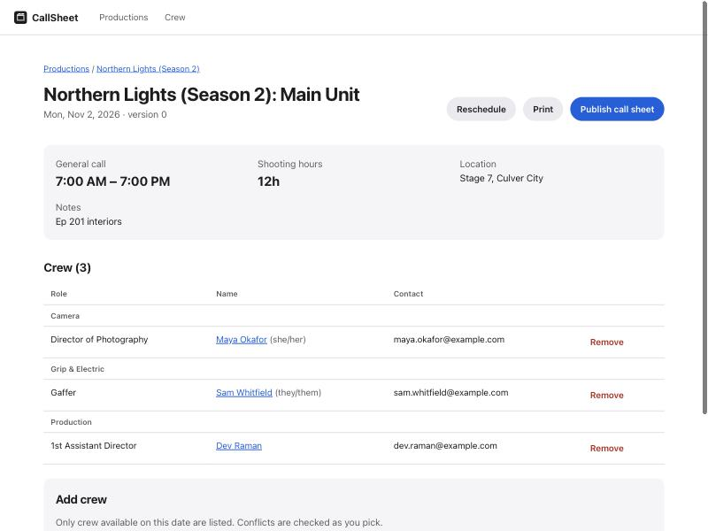
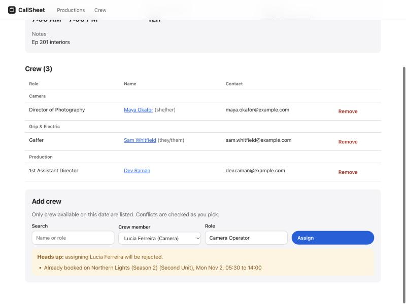
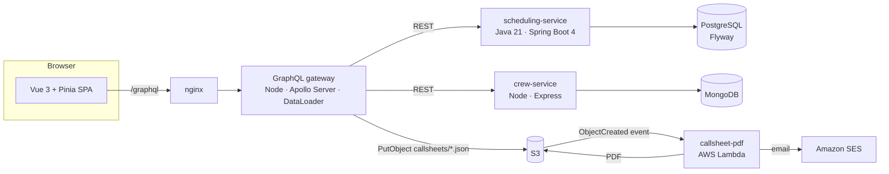

# CallSheet

**Production scheduling for film and TV: shoot days, crew and call sheets, with scheduling conflicts caught before they happen.**

[](https://github.com/opeoluwaAkinola/callsheet/actions/workflows/ci.yml)

A production coordinator builds each shoot day, assigns crew, and publishes a call sheet. CallSheet checks every assignment against the crew member's other commitments, **across units and across productions**, and blocks double-bookings and turnaround violations (too little rest between wrap and the next call).

<p>
  
  
</p>

## Architecture



| Component | Stack | What it does |
|---|---|---|
| [`services/scheduling-service`](services/scheduling-service) | Java 21, Spring Boot 4, JPA, PostgreSQL, Flyway, JUnit 5 | Productions, shoot days, assignments, and the **conflict engine**. REST API with OpenAPI docs and RFC 9457 problem responses. |
| [`services/crew-service`](services/crew-service) | Node 20, Express, MongoDB, Zod, Vitest | Crew directory, departments, availability windows. Batch endpoint for the gateway. |
| [`services/gateway`](services/gateway) | Node 20, Apollo Server 4, DataLoader | One graph over both services. Batches crew lookups and models conflicts as union types. Publishes call sheets to S3. |
| [`functions/callsheet-pdf`](functions/callsheet-pdf) | AWS Lambda (Node 20, arm64), PDFKit, SES | Triggered by S3. Renders an accessible, tagged PDF call sheet and emails the crew. |
| [`web`](web) | Vue 3, TypeScript, Pinia, Vue Router, Vite | The coordinator UI. Live conflict preview, optimistic-lock handling, print stylesheet. |
| [`infra/terraform`](infra/terraform) | Terraform (AWS) | S3 (encrypted, versioned, private), Lambda with least-privilege IAM, S3 trigger, CloudWatch alarm, ECR repos. |
| [`deploy/k8s`](deploy/k8s) | Kubernetes, Kustomize | Deployments with probes, resource limits, non-root and read-only filesystems, HPA, Ingress; local overlay for kind. |
| CI | [GitHub Actions](.github/workflows/ci.yml) and a [Jenkinsfile](Jenkinsfile) | Parallel builds, JUnit reports, Terraform validate, Kustomize render, Docker Compose end-to-end smoke test. |

## Quick start

You only need Docker.

```bash
docker compose up --build -d --wait
```

Open **http://localhost:8080**. Demo data loads automatically. Try the following:

1. Open **Northern Lights (Season 2) → Mon, Nov 2 → Main Unit**.
2. Under **Add crew**, pick *Lucia Ferreira*. A warning appears right away: she's on Second Unit that morning.
3. Open **Tue, Nov 3 → Main Unit** and pick *Kofi Mensah*. He's taping *Studio Sessions: Live* (a different production) that afternoon.
4. Click **Reschedule** in two browser tabs and save both. The second save is rejected instead of silently overwriting the first.

Other endpoints:

| URL | |
|---|---|
| http://localhost:4000/graphql | GraphQL endpoint (introspection enabled, so any GraphQL client or Apollo Sandbox can explore it) |
| http://localhost:8081/swagger-ui/index.html | scheduling-service OpenAPI docs |
| http://localhost:8081/actuator/prometheus | Prometheus metrics |

If ports 5432 or 27017 are already in use, set `POSTGRES_PORT=55432 MONGO_PORT=57017` before `docker compose up`.

```bash
./scripts/smoke-test.sh   # end-to-end checks against the running stack
make test                 # every unit and integration suite
docker compose down -v
```

## Engineering highlights

**Conflict detection is a pure domain model.** [`ConflictDetector`](services/scheduling-service/src/main/java/com/callsheet/scheduling/conflict/ConflictDetector.java) has no framework dependencies, and [its tests](services/scheduling-service/src/test/java/com/callsheet/scheduling/conflict/ConflictDetectorTest.java) cover overlaps, back-to-back days, turnaround in both directions and the exact boundary. The same rules run for the dry-run preview, for assignment and for rescheduling. Moving a day re-checks everyone already on it. ([ADR 3](docs/adr/0003-conflict-detection-as-pure-domain-logic.md))

**Conflicts are data, not exceptions.** REST returns `409` with a structured `conflicts` array. GraphQL returns `AssignSuccess | SchedulingConflict`, so the UI handles both outcomes with type safety. ([ADR 1](docs/adr/0001-graphql-gateway-over-rest-services.md))

**Concurrent edits are safe.** Shoot days carry a JPA `@Version`. A stale update gets a `409`, becomes a `STALE_UPDATE` GraphQL error, and the UI says "someone else changed this" with a one-click reload.

**No N+1 calls across services.** A per-request DataLoader collapses every `Assignment.crewMember` in a query into one `GET /api/crew/batch` call, and a test asserts this.

**Polyglot persistence with clear ownership.** Relational integrity (foreign keys, CHECK constraints, unique constraints) lives in PostgreSQL, and flexible profiles live in MongoDB. Services share only opaque ids. ([ADR 2](docs/adr/0002-polyglot-persistence.md))

**Accessibility is tested, not assumed.** The UI uses landmarks, a skip link, labelled controls and `aria-live` announcements, and moves focus to the page heading on route change. It respects `prefers-color-scheme` and `prefers-reduced-motion`. An **axe-core** test runs in CI, and the PDF is a tagged PDF.

**Production-minded infrastructure.** Containers run as non-root with read-only filesystems and dropped capabilities. Every service has startup, liveness and readiness probes. IAM is least-privilege and scoped to object prefixes. S3 is encrypted and versioned, and Lambda has X-Ray tracing and an error alarm.

## Tests

| Suite | Count | Tools |
|---|---|---|
| scheduling-service | 18 | JUnit 5, AssertJ, MockMvc, Flyway migrations on H2 (PostgreSQL mode) |
| crew-service | 17 | Vitest, Supertest, in-memory repository |
| gateway | 9 | Vitest, Apollo `executeOperation`, mocked upstreams |
| callsheet-pdf | 4 | Vitest, mocked S3 and SES |
| web | 7 | Vitest, Vue Test Utils, axe-core |
| end-to-end | 6 checks | [`smoke-test.sh`](scripts/smoke-test.sh) against Docker Compose |

## Deploying to AWS

```bash
make lambda                                   # bundle the Lambda
cd infra/terraform
cp terraform.tfvars.example terraform.tfvars  # set region, optional SES sender
terraform init && terraform apply
```

Set the `callsheet_bucket` output as `CALLSHEET_BUCKET` on the gateway, and attach `gateway_publish_policy_arn` to its service account. Publishing a call sheet then writes JSON to S3, the Lambda renders the PDF next to it, and the crew get an email.

For Kubernetes, `deploy/k8s/overlays/local` runs everything on a local [kind](https://kind.sigs.k8s.io/) cluster (instructions are in the [kustomization](deploy/k8s/overlays/local/kustomization.yaml)). For EKS, point the image tags at the ECR repositories from Terraform and supply `callsheet-db` from RDS and DocumentDB (or Atlas).

## Roadmap

- Authentication and roles (producer, coordinator, crew) through OIDC at the gateway
- OpenTelemetry tracing across gateway, services and Lambda, exported to Datadog
- GraphQL subscriptions so open call sheets update live
- Location and equipment scheduling, using the same conflict engine
- Playwright end-to-end tests in CI

## License

MIT
